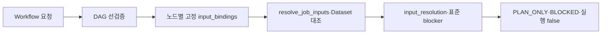

# Gate Workflow Input 20261017 — 계획 노드의 고정 입력 대조

| 필드 | 값 |
|---|---|
| updated_at | 2026-10-17 23:36 KST — Git 상태 메타데이터 정정; 본문은 해당 Gate 기준 |
| source_commit | d474d5bce6c2a6c4bd8ba141c9256d15f6004631 (108까지 구현 검토 기준; 이 메타데이터 정리는 후속 문서 커밋) |
| evidence_paths | `docs/implementation/28_workflow_input_resolution.md`; `backend/app/gmais_api.py`; `tests/test_gmais_workflow_extension.py`; `evidence/integration/workflow-input-tests-20261017.log`; `evidence/integration/workflow-input-full-tests-20261017.log` |
| confidence | 현재 코드·관련 TestClient 시험 로그 대조; 실제 실행·기관 승인 검증 아님 |
| status | TESTED_SYNTHETIC: 고정 입력 진단; 실제 DAG 실행 BLOCKED |

## 한 문장·1분 설명

분석 순서표의 각 단계가 실제 등록된 자료를 가리키는지 검사하도록 연결했다. 맞는 자료에는 불필요한 누락 오류를 붙이지 않지만 실행 권한은 부여하지 않는다. 여행 일정표에 각 예약을 확인한 것이 실제 출발 허가와 다른 것처럼 계획 검사와 실행을 구분한다.

## 왜·이론·5분 흐름

이전 계획 API는 입력이 있어도 Registry adapter가 없다는 DATA_MISSING을 무조건 남겼다. 이제 Workflow schema·노드 ID·의존성·순환을 먼저 검사하고 유효한 DAG에서만 각 노드의 input_bindings를 입력 진단 코어로 전달한다. 잘못된 DAG는 Registry나 자산 검사를 시작하지 않는다.

## 코드·입력·출력

`backend/app/gmais_api.py:plan_workflow`의 `POST /v1/workflows/plan`이 `backend/app/job_inputs.py:resolve_job_inputs`를 호출한다. 응답의 각 nodes[].input_resolution에 `greenblue.workflow-input-resolution.rfc1`/`INTERNAL_REVIEW`, evaluated_at, `PLAN_REQUEST_SNAPSHOT_NOT_EXECUTION_AUTHORIZATION`을 기록한다. 요청 schema는 유지한다.

상세 오류는 기존 표준 분류에 detail_code/input_index로 연결한다. 누락·빈 입력은 DATA_MISSING, ACL 미연결은 FORBIDDEN, Registry 장애는 RESOURCE_UNAVAILABLE, 참조·URI 충돌은 SCHEMA_MISMATCH, 나머지 무결성·품질 오류는 DATA_QUALITY다. 제한자료 경로·URI·원문 manifest·예외는 노출하지 않는다.

같은 자료 ID의 다른 고정 version은 T1/T2로 허용하고 동일(id,version) 다른 SHA는 해당 노드에서 차단한다. 노드 입력을 합치지 않아 서로 다른 노드 사이의 가짜 충돌을 만들지 않는다. RAW·제한자료는 지문이 맞아도 품질·ACL 사유가 남는다. `input_integrity_verified`만으로 입력 승인이라고 읽지 않는다.

## 현재성·실행 경계

Workflow는 같은 workflow_run_id/trace_id라도 매 요청 현재 파일을 다시 검사한다. Job의 동일 멱등 요청은 최초 저장 snapshot을 재생하므로 두 경로의 현재성 범위가 다르다. Workflow 계획은 영속 계획·Job/Result/Trace를 만들지 않으며 실제 카탈로그에 쓰지 않는다. node.execution_authorized, 전역 can_execute/execution_started는 false, mode는 PLAN_ONLY다. 정상 입력과 강제 READY Agent가 있어도 실행기 미연결 fallback MODEL_NOT_READY로 비실행을 유지한다.

## 시험과 한계

관련 `test_gmais_workflow_extension.py`는 기존7+신규7=14 PASS·3.910초다. 임시 Store/계약 fixture의 DAG 선검증·입력 대조·품질/ACL 차단·버전 비교·파일 재검사·READY 강제 비실행·원본/카탈로그 불변·Job/Result/Trace 미생성을 확인했다. 독립 검토에서 추가 재현 결함은 없었다. 기존 API 프로세스를 재시작하지 않았으므로 HTTP 검증은 TestClient 범위다. 전체 최종 회귀는247건/139.318초/OK(skipped=1), 즉246 PASS·1 SKIP다. 기존 실제 OS symlink 생성권한 부족1건을 건너뛰었고 deterministic mock 경계시험은 통과했다.

실제 DAG 스케줄링·의존 상태 전파·STOP_DEPENDENTS/FAIL_ALL 실행·retry/timeout/cancel·동적 출력 바인딩·Result 생성, 기관 ACL·자료 의미 적합성·승인 모델은 후속이다. 원본1,111과 후보 예상1,095·bare 부족·실자료 학습 차단·외부5 미구현·운영 미승인은 그대로다.

## 발표·10분 확장·Q&A

30초: “계획의 각 단계가 고정된 실제 자료를 가리키는지 대조합니다. 정상 자료의 불필요한 누락 오류는 제거했지만 모델·기관 승인과 실제 실행기는 별도여서 지금은 계획 검토만 합니다.”

5분은 DAG→노드 대조→오류→실행 경계를, 10분은 Job/Workflow 현재성 차이·노드 독립성·RAW/제한자료 사례·동적 실행의 남은 일을 확장한다. 슬라이드: 순서표 / 고정 자료 / 오류와 권한 / 실행 전의 문턱.

Q1. 입력 연결이 실행인가? A. 계획 진단이다.

Q2. 정상 입력인데 왜 BLOCKED인가? A. 모델·Agent·실행기 gate가 남는다.

Q3. 다시 보내면 새 검사인가? A. Workflow는 현재 파일을 다시 검사하고 Job 재생은 최초 진단이다.

Q4. 지문 true면 제한자료 사용 가능한가? A. ACL blocker와 권한 검증은 별도다.

Q5. 다음 단계는? A. 승인된 모델·기관 권한·의미 검증·실행기·의존 상태 전파와 실행 직전 재검증이다.

## 시연·다음 갱신

[시연](../presentations/DEMO_STORY.md)에 문서28과 fixture 로그를 읽는 설명을 추가한다. 실제 수집·자료등록·학습·Job 실행을 시연 목적으로 만들지 않는다. 다음 변경의 설계/API/사용법/시험/인계와 이해자료를 같은 완료 조건으로 갱신한다.

### Workflow 입력 연결 후 최종 전체시험

`workflow-input-full-tests-20261017.log`를 읽어 `scripts/test.ps1`의247건/139.318초/OK(skipped=1), 즉 **246 PASS·1 SKIP**를 확인했다. SKIP은 기존 실제 OS symlink 생성권한 부족이며 대체 mock 경계시험은 통과했다. 관련 Workflow14 PASS·3.910초는 이 전체시험에 포함된 부분이며 이전240건·225건·197건에 산술 합산하지 않는다. 이해 에이전트가 재실행한 것이 아니라 개발팀의 완료 로그를 읽은 근거다. 이전 전체시험 수치는 개발 이력이고 현재 판정은 이 절이 우선한다.

실제 API 프로세스 재시작·실자료 수집/학습·Job/Result 실행은 하지 않았다. 고정 입력 진단은 PLAN_ONLY·BLOCKED 범위이고 과학·기관·운영 승인 및 실제 DAG 실행 gate는 유지한다.
