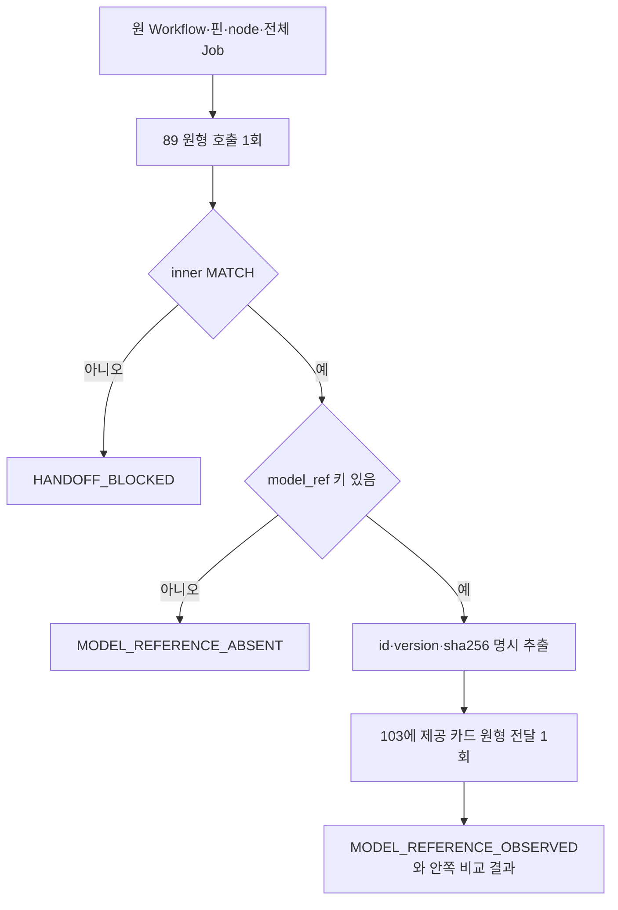

# Gate 104 — 전체 Job 검토 뒤 모델 카드 대조

| 항목 | 내용 |
|---|---|
| updated_at | 2026-10-17 23:36 KST — Git 상태 메타데이터 정정; 본문은 해당 Gate 기준 |
| source_commit | d474d5bce6c2a6c4bd8ba141c9256d15f6004631 (108까지 구현 검토 기준; 이 메타데이터 정리는 후속 문서 커밋) |
| evidence_paths | `backend/app/workflow_job_model_record_handoff.py`; `tests/test_workflow_job_model_record_handoff.py`; `evidence/integration/workflow-model-record-focused-20261017.log`; `evidence/integration/workflow-model-record-related-20261017.log`; `evidence/integration/workflow-model-record-independent-20261017.log`; `docs/implementation/104_workflow_job_model_record_handoff.md`; `evidence/integration/workflow-model-record-catalog-observation-20261017.json`; `evidence/integration/workflow-model-record-live-integrity-20261017.json` |
| confidence | 완료 코드·합성 시험·보존 증거 확인; 운영 Workflow 검증 아님 |
| status | TESTED_SYNTHETIC; 기존 학습 BLOCKED; 전체 개발 진행 중 |

## 쉬운 설명

서류 접수 창구에서 먼저 주문서 전체가 맞는지 확인한다. 주문서가 통과하고 모델 참조도 있을 때만, 적힌 이름·버전·지문을 옆에 놓인 모델 카드와 비교한다. 카드는 호출자가 주며 창고나 데이터베이스에서 찾아오지 않는다.

`MODEL_REFERENCE_OBSERVED`는 “대조를 해 보았다”는 흐름 표시다. 카드가 일치했다거나 모델을 사용할 수 있다는 뜻이 아니다. 카드 미제공도 이 흐름 상태 안에 들어가므로 안쪽 비교 결과를 함께 읽어야 한다.

## 이론적 배경과 구조

앞 단계의 계약 검증을 통과한 입력만 다음 단계에 전달한다. 기존 검토 결과를 고쳐 쓰지 않고 별도 결과에 담아, 전체 Job 대조와 모델 카드 대조를 구분한다. 선언의 일치와 원본 인증도 분리한다.

## 코드와 데이터 동작

`compare_workflow_job_model_record_handoff(workflow_request, pinned_workflow_request_sha256, selected_node_id, full_job_request, model_record=None)`는 기존89를 원래 네 인자로 정확히 한 번 호출하고 반환 객체를 그대로 `full_job_comparison`에 담는다.

inner가 BLOCKED이면 wrapper가 추가로 model_ref나 candidate를 접근하지 않고103도 호출하지 않는다. 이는89 내부의 기존 검증까지 생략했다는 뜻이 아니다. inner MATCH이고 참조 키가 없으면 `MODEL_REFERENCE_ABSENT`다. 키가 있으면 검증된 세 값을 새 exact3 identity에 명시 추출하고 후보 카드는 원 객체 그대로103에 한 번 전달한다.

출력은 고정12키이며 바깥 상태는 세 가지다. 안쪽103 결과가 미제공·잘못된 카드·충돌·비교 불가·일치 미검증 중 무엇인지는 별도로 읽는다. None 카드는 caller 미제공이지 DB 미발견이 아니다.89를 실제로 통과한 참조는 이미 유효하므로 자연 조합에서103의 REFERENCE_INVALID는 도달하지 않는다.103 여섯 상태의 모의 embed 시험과 실제 함수 조합의 다섯 도달 상태를 구분한다.

기존 role 문자 검사는 유지한다. URI는 기존 schema의 문자열 조건과 전체 JSON 한도만 적용하며 위치·실체·원격 정책을 확인하거나 해석하지 않는다. 권위·실바이트·실행·과학·model_verified 다섯 축은 언제나 false다. 기존 모델의 평가값을 변경한 뜻이 아니다.

## 시험 증거

신규12 PASS/0.128초, 관련61 PASS/0.887초, 독립12 PASS/0.182초의 보존 로그를 읽었다. 신규는 관련 묶음에 포함된다. 보호141·기존 core72·기존 제품·이전 증거721·catalog14는 불변이다. 실제 자료는 catalog 보존만 읽었으며 새 wrapper에 운영 Workflow 참조를 적용하지 않았다.

시험은 원89 객체 embed·정확 호출 수·차단 뒤 추가 접근 금지·명시 projection과 후보 객체 동일성·날짜/null/별칭/role/bbox 차단·소수/URI 보존·기존24false·예외 전파·순환 unknown 미순회를 확인했다. schema cache를 비운 합성 호출에서 파일 읽기1회, 이후 호출에서 추가0회를 관측했다. 기존 `schema_files_read`는 null 그대로이며 전체 IO가 없다고 말하지 않는다. wrapper의 추가 파일/DB/network 읽기0과 기존89 cold schema 읽기를 구분한다.

## 한계와 화면 영향

새 내부 함수는 기존 API/UI·Workflow89/94·승인 gate의 호출 경로에 연결하지 않았다. 직접 화면 수정·프론트/build/브라우저 재시험은 없다. 이번 전체 backend도 재실행하지 않았다. 이전1019건/1018 PASS/1 SKIP/381.288초는101/102의 역사 근거다.

모델 카드를 선택·조회하는 resolver, 기관 권위, 현재 파일, 실제 capability·과학·실행 승인을 검증하지 않는다. 새 기능의 성공은 TESTED_SYNTHETIC이며 운영 Workflow 참조 검증이 아니다. 기존 후보 QA4차단·학습 BLOCKED를 유지한다. 전체 개발과10분 보고는 계속된다.

## 발표 스크립트

### 1분

“먼저 전체 주문서를 확인하고, 통과한 주문에 모델 참조가 있을 때만 제공된 모델 카드와 비교하도록 연결했습니다. 기존 주문서 검토 결과는 그대로 보관합니다. 참조가 없거나 검토가 막히면 카드 비교를 하지 않습니다. 비교를 해 보았다는 표시와 카드가 일치했다는 결과는 다릅니다. 카드가 전달되지 않은 경우도 안쪽 결과로 구분합니다. 파일이나 데이터베이스에서 카드를 찾지는 않습니다. 합성 시험으로 순서와 경계를 확인했으며 실제 실행과 승인에는 연결하지 않았습니다.”

### 5분 순서

첫1분은 접수 창구 비유와 필요성을 설명한다. 두 번째1분은 기존89 검토와 참조 유무를 나눈다. 세 번째1분은 명시 세 키와103 안쪽 결과를 보여준다. 네 번째1분은 호출 수·차단 후 접근 금지·cold schema 읽기 시험을 설명한다. 마지막1분은 관측과 인증의 차이, 실제 운영과 화면의 미연결을 말한다.

### 10분 확장과 슬라이드

슬라이드는 접수 순서, 원결과 보존, 세 흐름 상태와 안쪽 상태, 시험, 미검증 경계 순서로 구성한다. 5분 설명 뒤에는 실제 다섯 도달 상태와 모의 여섯 상태를2분, schema IO 범위를1분, 예외와 후속 연결 책임을1분, 질문을1분 배정한다.

## Q&A

Q. OBSERVED이면 카드가 맞는가? A. 대조가 수행됐다는 뜻이다. 안쪽 결과가 충돌이나 미제공일 수도 있다.

Q. 차단하면 파일을 전혀 읽지 않는가? A. wrapper의 추가 접근은 막지만 앞선89가 cold schema를 읽을 수 있다.

Q. URI가 있으면 모델을 찾았다는 뜻인가? A. 문자열 검증만 유지한다. 경로·원격 정책·파일 존재를 확인하지 않는다.

Q. 현재 화면에서 쓸 수 있나? A. 새 wrapper는 내부 함수이며 API/UI에 연결하지 않았다.

## 다음 단계와 근거

읽기 전용 wrapper API의 계약 검토는 PLANNED다. 기존89/RFC1·94/RFC2 형식을 유지하고 caller 제공 카드만 받는 방향이다. 등록 원장 자동 조회 없이 strict JSON 오염·크기·SHA·역할 검증과 수동 연결을 검토한다. 아직 endpoint/UI 구현은 없다.

[구현 계약](../../implementation/104_workflow_job_model_record_handoff.md), [완료 코드](../../../backend/app/workflow_job_model_record_handoff.py), [독립 로그](../../../evidence/integration/workflow-model-record-independent-20261017.log)를 읽는다.
