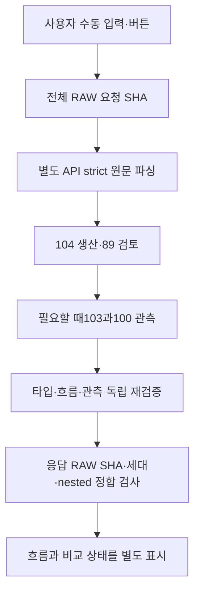

# Gate105/106 — 제공 모델 카드와 전체 Job의 수동 대조

| 항목 | 내용 |
|---|---|
| updated_at | 2026-10-17 23:36 KST — Git 상태 메타데이터 정정; 본문은 해당 Gate 기준 |
| source_commit | d474d5bce6c2a6c4bd8ba141c9256d15f6004631 (108까지 구현 검토 기준; 이 메타데이터 정리는 후속 문서 커밋) |
| evidence_paths | `backend/app/workflow_job_model_record_handoff_api.py`; `tests/test_workflow_job_model_record_handoff_api.py`; `docs/implementation/105_workflow_job_model_record_handoff_api.md`; `docs/implementation/106_workflow_model_record_handoff_ui.md`; `frontend/src/WorkflowModelRecordHandoff.tsx`; `frontend/src/workflowModelRecordHandoffAdapter.ts`; `frontend/src/workflowModelRecordHandoffAdapter.test.mjs`; `frontend/src/workflow-model-record-handoff.css`; `tests/test_model_registration_provenance_api.py`; `evidence/integration/workflow-model-record-api-focused-20261017.log`; `evidence/integration/workflow-model-record-api-related-20261017.log`; `evidence/integration/workflow-model-record-api-independent-20261017.log`; `evidence/integration/workflow-model-record-api-full-tests-20261017.log`; `evidence/integration/workflow-model-record-api-full-tests-final-20261017.log`; `evidence/integration/workflow-model-record-api-live-api-20261017.json`; `evidence/integration/workflow-model-record-api-live-ui-20261017.json`; `evidence/integration/workflow-model-record-api-live-integrity-20261017.json`; `evidence/integration/workflow-model-record-api-test-compat-baseline-20261017.json`; `evidence/integration/workflow-model-record-api-test-compat-focused-20261017.log`; `evidence/integration/workflow-model-record-api-test-compat-original-20261017.py`; `evidence/integration/workflow-model-record-api-test-compat-result-20261017.json`; `evidence/integration/workflow-model-record-api-next-queue-review-20261017.json`; `evidence/integration/workflow-model-record-ui-related-initial-failure-20261017.log`; `evidence/integration/workflow-model-record-ui-related-20261017.log`; `evidence/integration/workflow-model-record-ui-independent-20261017.log`; `evidence/integration/workflow-model-record-ui-tests-20261017.log`; `evidence/integration/workflow-model-record-ui-build-20261017.log`; `evidence/integration/workflow-model-record-ui-desktop-20261017.png` |
| confidence | 완료 코드·시험·실제 HTTP/브라우저·보존 근거 확인; 운영 모델 인증 아님 |
| status | TESTED_SYNTHETIC; 실제 HTTP·브라우저 경로 VERIFIED_REAL 한정; 학습 BLOCKED; 후속 PLANNED |

## 쉬운 설명

사용자가 작성한 주문서와 상품 카드를 창구에 함께 내고 비교하는 화면이다. 기존 전체 Job 초안 검토 뒤, 별도의 접힌 창에 선택 노드·전체 Job 원문·선택 모델 카드 원문을 직접 넣는다. 프로그램이 등록 목록에서 카드를 찾아 주거나 빈칸을 자동으로 채우지 않는다.

버튼을 눌러 대조했더라도 실제 상품을 열거나 작성자의 권위를 확인한 것은 아니다. 바깥 OBSERVED는 대조 수행이며 안쪽 결과가 미제공·오류·충돌일 수도 있다. 안쪽 MATCH_UNVERIFIED도 선언이 같다는 뜻이다.

## 이론적 배경과 구조

전송 원문과 비교의 논리 단계를 구분한다. 서버는 세 JSON 원문을 먼저 엄격하게 파싱한다. 그 뒤 기존89의 전체 Job 검토와104의 명시 추출·103 비교를 수행한다. 응답 검증은 원 결과의 타입과 상태 조합까지 확인한다. false와 숫자0을 같은 값으로 받아들이지 않는다.

## 코드와 데이터 동작

`POST /v1/workflows/full-job-model-record-handoff`는 기존 네 문자열 필드와 선택 `model_record_json` 문자열만 받는다. 기존 RFC1/RFC2 경로는 유지한다. 선택 키를 생략하면 카드 None이며 문자열 `null`도 파싱 뒤 None이다. transport null은400이다. UI는 완전히 빈 입력만 키를 생략하고 공백은 원문을 보내 JSON 오류를 받는다. 미제공은 DB 미발견이 아니다.

전체 body1MiB·세 원문 각512KiB다. Workflow는 기존 정수 프로토콜, Job와 카드는 유한 소수·지수를 지원하는 strict parser를 쓴다. 중복 키·잘못된 UTF8·NaN 등은400, 예산 초과는413이다. API는89 gate 전에 카드 원문도 파싱한다.104의 차단 뒤 추가 candidate 접근0과 transport 파싱을 혼동하지 않는다.

한 threadpool 작업에서104 생산1회 뒤 원89 safe 검증과 nested103/100의 정확한 타입·값 대조를 수행한다. OBSERVED이면103을 검증 목적으로 추가1회 재산출한다. 같은 ID의 내부 관측 가지는 생산100 1회+검증100 1회이며, 응답의 호출 카운터는 생산 범위다. 검사 불일치·오염·자원 오류는 상세 없는503, router 응답은 no-store다. 기존 main 인증을 유지한다.

UI는 새 요청 전체 RAW SHA를 먼저 확인한다. nested89는 기존 네 필드의 별도 결합 SHA로 재포장해 기존 adapter를 재사용한다. 새 body SHA와 기존 네 필드 SHA를 같은 값으로 취급하지 않는다. Job·카드의 JS float canonical SHA를 Python 관측 hash와 대조하지 않는다. 표시 검사는 원본·작성자 신원 인증이 아니다.

입력·Workflow·revision·route/back·unmount는 세대를 폐기한다. digest 준비 중 바뀌면 POST 전에 중단하고 이미 보낸 요청의 늦은 응답은 표시하지 않는다. 중복 클릭 방어가 있으며 표시 중단은 서버 취소가 아니다. 기존 계획·계보·노드·전체 Job 검토와 독립된 상태를 사용한다. 공통 SVG와 scoped CSS를 쓴다.

## 시험 증거와 상태

API 집중15 PASS/1.736초·관련101 PASS/6.697초·독립15 PASS/2.894초다. UI 신규19 PASS/2815.4243ms·독립19 PASS/2988.2351ms·전체191 PASS/8678.6347ms·build96 modules/28.34초다. 반복과 Python 교차 사례를 별도 합산하지 않는다.

최초 UI18/19 실패는 sibling JSX를 검사한 시험 정규식 오타였으며 제품 변경 없이 검사 문자열을 수정했다. 초기 실패 로그를 보존했다. 실제 HTTP는 합성 선언10사례의200/400/413 확인이며 실제 운영 Workflow·모델 검증이 아니다. 최종 backend1060건/1059 PASS/1 SKIP/364.175초와 아래 실제·보존 근거를 확인했다.

## 한계

기관 권위·실제 바이트·실행·과학·model_verified는 항상 false다. 기존 모델 평가값 변경을 뜻하지 않는다. Store/Registry 조회·모델 선택·resolver·등록·Job 생성·학습을 하지 않는다.89 cold schema 읽기 가능성과 추가 artifact/DB/network IO0을 구분하고 schema_files_read null을0으로 바꾸지 않는다. 기존 후보QA4차단·학습 BLOCKED를 유지한다.

## 발표 스크립트

### 1분

“사용자가 작성한 주문서와 모델 카드를 직접 비교하는 별도 창을 붙였습니다. 노드와 주문서, 카드를 직접 넣고 버튼을 눌러야 합니다. 모델 목록에서 자동으로 가져오지는 않습니다. 먼저 주문서의 입력 전달을 확인하고 필요한 경우 모델 이름과 버전, 지문을 비교합니다. 비교 수행과 일치는 다른 표시이며 일치해도 미검증입니다. 실제 파일이나 작성자의 권위를 확인하지 않았기 때문입니다. 편집하거나 화면을 이동하면 이전 결과를 버립니다. 등록·학습·실행을 시작하는 기능은 아닙니다.”

### 5분 순서

첫1분에는 수동 창과 주문서·카드 비유를 설명한다. 다음1분에는 빈 입력·null·오류와 엄격 원문 검사를 설명한다. 세 번째1분에는 기존89와104·103의 세 단계를 설명한다. 네 번째1분에는 요청 SHA와 응답·화면 세대 검증을 설명한다. 마지막1분에는 합성 시험과 실제 서버 관측, 원본 인증·실행 승인의 한계를 나눈다.

### 10분 확장과 슬라이드

입력 예시, 전송 한도, 생산과 재검증, 화면 상태, 증거·한계 순서로 구성한다. 5분 뒤 추가로 counter 범위와false/int 오염을2분, 중복JSON 및 null 차이를1분, 이전 패널 독립과 표시중단을1분, 질문을1분 배정한다.

## Q&A

Q. 레코드를 비워 두면 DB를 검색하나? A. 미제공으로 비교할 뿐 조회하지 않는다.

Q. BLOCKED인데 잘못된 카드 JSON이400인 이유는? A. transport 파싱은 core gate보다 먼저 수행한다.

Q. 호출 수가1인데 내부 관측은2회인가? A. 응답 카운터는 생산 범위이며 API의 독립 재검증 호출은 별도다.

Q. 응답 표시 중단은 서버 취소인가? A. 화면에 늦은 결과를 붙이지 않는 방어이며 서버 작업 취소는 아니다.

Q. URI와 SHA가 같으면 실제 모델을 찾았나? A. URI 해결과 파일 읽기를 하지 않는다. 선언값 일치와 현재 바이트·기관 권위 검증은 별도다.

## 실제 HTTP·브라우저 관측 — 합성 입력 한정

실제8002 서버 HTTP의 합성10사례에서200/400/413을 확인했다.5174 화면에서는11체크가 모두 통과했고 수동 진단POST4회를 수행했다. 카드 생략·합성 일치 미검증·공백400·문자열 null의 미제공을 확인했다. 편집 즉시 이전 결과 제거, Workflow 편집 뒤 원문 복원, route/back 뒤 원 Workflow 정확 보존과 새 세 필드 공백도 확인했다.

실측1449×1087에서 문서·패널 가로넘침0·제목 겹침0·SVG 정상이다. 시험시작 이후 최근20 warn/error에 새 오류가 없었다. 전체 콘솔 역사0이나 모바일·강제지연·서버취소 검증은 아니다. 편집으로 보이는 결과가 없었다는 것은 전 네트워크 요청 계측이 아니다. 완료응답 후 route/back을 확인했고 지연 경합은 격리 시험이다.

저장 PNG는 합성 카드의 일치 미검증 상태이며 정리 뒤 빈 상태 화면이 아니다. 진단POST는 Job 생성POST가 아니고 운영 모델 등록도0이다. 실제 HTTP/브라우저 관측을 운영 Workflow·모델 바이트·기관 권위·과학 승인 검증으로 확대하지 않는다.8000/8001 새 소스 적용은 미확인으로 유지한다.

## 전체 회귀 초기 실패 보존

첫 전체1060건 실행은 기존101 시험의 AST 허용 목록이 새105 라우터 import/include를 거부해1실패·1기존SKIP였다. 초기 로그를 보존한다. 해당 시험의 좁은 호환 보완 뒤 별도 최종 로그에서1059 PASS/1 SKIP을 확인했다. 초기 실패를 최종 통과로 덮어쓰지 않는다.

### 시험 호환 보완 범위

기존101 시험은 새 라우터의 정확한 import/include 두 줄만 허용하고 나머지 전체 AST와 순서 비교는 유지하도록 보완했다. 관련24 PASS/4.702초이며 제품 소스 변경이 아니다. 최초 전체 실패 로그는 덮어쓰지 않았고 최종 전체는 별도 final 로그의 최종1060건/1059 PASS/1 SKIP으로 확인했다.

## 105/106 최종 확정 근거

최종 backend1060건/1059 PASS/기존 Windows symlink 권한1 SKIP/364.175초/exit0이다. 최초1060건/409.580초의 AST 시험1실패·1 SKIP 로그를 보존했고, 제품 수정 없이 기존101 시험의 허용 연결 두 줄만 좁게 보완한 뒤 별도 final 로그로 재실행했다. 호환24 PASS/4.702초와 반복 시험은 최종 전체에 합산하지 않는다.

보호141·이전 증거736·catalog14·기존 Job본문은 불변이다. 기존 core73 중72개는 바이트 불변이고 GeoQuery1개는 허용 import/child 두 부분만 추가됐으며 제거하면 원 바이트와 같다. 기존 추적 변경은 main.py·GeoQuery.tsx·101 호환 시험 세 파일뿐이다.73개 전부 불변이나 기존 제품0변경으로 표현하지 않는다.

실제 HTTP10사례와 브라우저11체크는 합성 진단 입력의 실제 전송·표시 확인이다. 운영 Workflow·모델 인증·Job 생성·원장 역채움·새 운영 QA·훈련·실행·승인은 없다. 기존 모델/원본/정책/분할·예약136314880B·후보QA4차단·학습 BLOCKED를 유지한다.

다음 후보는 세 호출자의 Workflow 의존성 순서 계산을 공통 순수 helper로 묶을 수 있는지 읽기 검토하는 PLANNED다. 현재 서로 다른 동작 결함을 확인한 것이 아니며 구현·시험·DAG 승인·동적 선행 입력 연결은 없다. 전체 개발과10분 보고는 계속된다.

[구현 API](../../implementation/105_workflow_job_model_record_handoff_api.md), [UI 계약](../../implementation/106_workflow_model_record_handoff_ui.md), [최종 전체 로그](../../../evidence/integration/workflow-model-record-api-full-tests-final-20261017.log)를 확인한다.
