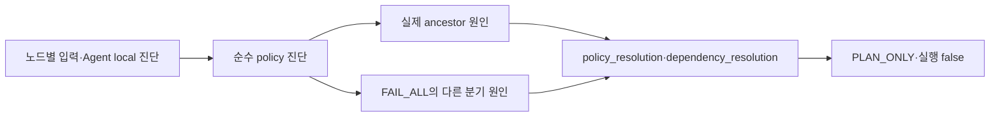

# Gate Workflow Policy 20261017 — 왜 멈추는지 설명하기

| 필드 | 값 |
|---|---|
| updated_at | 2026-10-17 23:36 KST — Git 상태 메타데이터 정정; 본문은 해당 Gate 기준 |
| source_commit | Git 연결됨; 문서 작성 시 변경분 미커밋, evidence snapshot SHA로 추적 (원격 기준 d483d25) |
| evidence_paths | `backend/app/workflow_policy.py`; `docs/implementation/29_workflow_blocking_policy.md`; `evidence/integration/workflow-policy-core-tests-20261017.log`; `evidence/integration/workflow-policy-api-tests-20261017.log`; `evidence/integration/workflow-policy-full-tests-20261017.log`; `docs/implementation/30_workflow_diagnostics_ui.md`; `frontend/src/InputDiagnostics.tsx`; `frontend/src/inputDiagnosticsAdapter.ts`; `evidence/integration/workflow-policy-ui-build-20261017.log`; `evidence/integration/workflow-policy-live-ui-20261017.json`; `evidence/ui-20261017/workflow-diagnostics-live.png` |
| confidence | backend 코드·시험로그 및 로컬 UI 실제응답/화면 근거 대조; 과학·운영 승인 아님 |
| status | TESTED_SYNTHETIC: 정책·adapter시험; VERIFIED_REAL: 로컬 계획진단 UI; 실제 실행 BLOCKED |

## 한 문장·1분 설명

분석이 막힌 이유를 자기 단계의 문제, 실제 앞 단계 문제, 전체 중지 규칙의 문제로 나누었다. 예약 하나의 누락과 연결편의 결항과 전체 일정 중지 규칙을 구분하는 것과 같다. 원인을 설명하는 계획 기능이며 실제 취소를 수행하지 않는다.

## 왜·이론·5분 흐름

원인을 모두 같은 목록으로 전파하면 독립 분기까지 선행 문제처럼 보이거나 diamond 경로를 두 번 세게 된다. `diagnose_workflow_blocking(reviewed_nodes,policy)`는 이미 검토한 local blocker만 seed로 사용하고 실제 ancestor를 계산한다. 전달 결과를 다시 seed에 섞지 않는다. STOP_DEPENDENTS는 ancestor 중 local 원인만 upstream_blocked_by에, FAIL_ALL은 다른 분기 local 원인을 policy_blocked_by에 표시한다. 자기 local은 두 목록에서 제외하며 전체원인 합집합에는 한 번 포함한다.

## 코드·입출력·예외

`backend/app/workflow_policy.py:diagnose_workflow_blocking`은 Store·파일·네트워크에 접근하지 않는 순수 함수다. `gmais_api.py:plan_workflow`는 schema/DAG와 입력 진단 뒤에 연결한다. 응답은 `greenblue.workflow-blocking-policy.rfc1`의 policy_resolution과 노드별 dependency_resolution이다. 기존 node.blockers와 status는 유지한다.

원본을 깊은 복사하고 정렬하여 순서가 달라도 결정적인 결과를 만든다. 중복 ID·없는 dependency·자기 의존·cycle·잘못된 정책은 거부한다. 반복 dependency와 opaque ID는 원문 schema 범위에서 허용한다. NO_BLOCKING_CAUSE_IDENTIFIED는 READY가 아니며 max_parallel/require_human_approval로 실행 허가를 만들지 않는다. 모든 execution_authorized=false, 전역 PLAN_ONLY/BLOCKED·can_execute/execution_started=false다.

## 시험·한계·UI 인계

코어9 PASS/0.011초, 관련 API20 PASS/6.965초, 전체262건/85.881초/OK(skipped=1), 즉261 PASS·1 SKIP를 보존 로그에서 확인했다. 원인 독립성·diamond·결정성·원본 불변·유효하지 않은 그래프와 비실행을 시험했다. 실제 OS symlink 권한 부족1건은 SKIP, mock 경계시험은 통과했다. 관련시험을 과거 전체 수에 더하지 않는다.

실제 Agent는 모두 차단 상태이므로 정책 차이는 node.status 전환이 아니라 원인 범위다. 깨끗한 독립 분기는 코어 fixture에서만 만들었다. 실제 scheduler·정책 실행·상태 영속화·retry/timeout/cancel·기관권한·모델과학/배포 승인은 후속이다.

Root가 최근 backend 진단의 UI 연결 미완료를 확인하고 web_ui에 GeoQuery/AgentCenter 진단카드를 인계했다. frontend 시험·build·문서30과 실행 서버·브라우저 확인 근거는 인계 대기다. backend 시험과 화면 적용을 합쳐 UI 완료로 표현하지 않는다. 완료된 UI는 후속 절에 기록한다.

## 발표·10분 확장·질문

30초: “자기 단계, 선행 단계, 전체 중지 규칙을 나눠 차단 원인을 설명합니다. 실제 실행·취소 기능은 아니며 화면 적용은 별도 근거로 확인합니다.”

5분은 local→ancestor→정책→응답→실행 경계를,10분은 독립 분기·diamond·정렬 결정성·UI와 서버 적용 차이를 확장한다. 슬라이드: 왜 멈췄나 / 선행과 정책 / 중복 없는 원인 / 화면과 실행의 경계.

Q1. FAIL_ALL이 모든 작업을 취소하나? A. 계획의 정책 원인 범위만 계산한다.

Q2. 원인 없음이면 실행되나? A. 아니다. 나머지 gate와 실행 false가 남는다.

Q3. 독립 분기도 선행 원인인가? A. STOP_DEPENDENTS는 아니며 FAIL_ALL은 정책 원인으로 따로 표시한다.

Q4. UI에 이미 보이나? A. 새5174의 실제 계획진단을 확인했다. 기존5173은 보존하며 모델 실행은 별도다.

Q5. 다음은? A. UI 적용 확인, 이후 실제 scheduler·상태 영속화·실행 승인과 운영 검증의 별도 단위다.

[시연 경로](../presentations/DEMO_STORY.md)는 UI 최종 근거를 받은 뒤 갱신한다. 코드·설계/API·사용법·시험·인계·이해자료와 UI 영향을 같은 완료 기준으로 확인한다.

## 최종 UI 근거와 시연

frontend `InputDiagnostics.tsx`/adapter가 입력 진단과 정책·노드 원인을 표시하고 민감 경로를 숨긴다. GeoQuery는실제계획응답을, AgentCenter는제출409snapshot을처리한다. 실제브라우저확인은GeoQuery계획경로이며AgentCenter새제출실행을만들지않았다.

신규5+기존5adapter=10PASS, 마지막productionbuild52modules/18.95초/종료0을확인했다. 새UI5174동일출처DEVproxy→API8001연결에서실행계획메뉴·빈입력3노드·STOP_DEPENDENTS/FAIL_ALL·PLAN_ONLY/BLOCKED·실행비활성을확인했다. 기존5173/8000은보존하고그주소의새API적용을주장하지않는다. API보안정책을넓히지않고개발proxy로CORS경계를해결했으며production은운영reverse proxy/CORS가별도다.

`workflow-policy-live-ui-20261017.json`과3개PNG가근거다. Catalog/원장/합산manifest전후SHA동일·기존gmais_jobs2건그대로·이번신규생성0·독립과학검증false다. 관련대기문단은이최종근거로대체한다. [시연](../presentations/DEMO_STORY.md)과[UI설명](../06_GEOLLM_SDSS.md)을최신주소/증거로갱신했다.

완료기준은backendAPI·상태/오류계약인계→화면연결→frontend시험/build→실행서버→실제브라우저→관련문서/이해자료다. UI단위완료로전체개발이나10분보고를중지하지않는다.
